# ROGII — Wellbore Geology Prediction

> Predicting **True Vertical Thickness (TVT)** along the un-logged section of horizontal oil wells by
> correlating gamma-ray logs — a sequence-alignment problem tackled with an anchor-then-residual ensemble
> that ends in a **learned "holistic reading"** of the log.

**Kaggle Featured Code Competition** · metric **RMSE** · notebook-only, ≤ 9 h, internet disabled.
[Competition page](https://www.kaggle.com/competitions/rogii-wellbore-geology-prediction)

---

## Result

| | RMSE (public LB) |
|---|---|
| Forward-fill baseline | 15.91 |
| **Final submission** (kernel v27) | **10.70** |
| Improvement | **−5.21 (−33%)** |

Every one of those points was validated on the real hidden leaderboard, and the whole pipeline is
**fully honest and rules-compliant** — no target leakage, no train-only features at inference, licensed
models only. The remaining gap to the very top of the board is a train/test well-ID *leak* that the leading
public notebooks exploit; it does not transfer to the private board, so it was deliberately **not chased**.

The story of getting here is, honestly, the interesting part: I twice declared an "honest ceiling" and was
twice proven wrong — first by **feature-poverty** (13.5 → 13.0), then by **architecture-poverty**
(11.0 → 10.7). Both breakthroughs came from questioning an assumption, not from tuning.

---

## The problem

Each horizontal well provides a **gamma-ray (GR) log** sampled along measured depth, plus the trajectory
(`X, Y, Z`). A separate vertical **typewell** gives the GR signature as a function of TVT. The target — TVT,
the bit's geological position — is known along the early ("known") part of the well and **missing (`NaN`)
along a long evaluation zone** (~74% of the well on the median).

The horizontal GR is a stretched, shifted copy of the typewell GR, so recovering TVT is fundamentally
**log correlation / sequence alignment** — the automated analogue of what a geosteering geologist does by
eye. The catch: the GR signal is weakly discriminative (self-correlation ≈ 0.65 at the true depth), so
point-by-point matching barely beats forward-fill. The signal lives in the *structure*, not the points.

---

## Approach — anchor-then-residual ensemble

The design principle throughout: **ensemble diversity must come from a genuinely different algorithm, not a
restatement.** A per-well level *anchor* pins the absolute depth; a fusion of physics-style *trackers*
handles trajectory-coupled motion; and a stack of *decorrelated learners* predicts the residual the anchor
misses. The final blend combines them.

```mermaid
flowchart LR
    subgraph ANCHOR["Level anchor + tracker fusion"]
        A["Ridge level anchor<br/>(per-well offset)"]
        H["2nd-order HMM<br/>(TVT, dip-rate)"]
        P["Particle filters<br/>(bootstrap + 8-seed likelihood)"]
    end
    subgraph FEAT["Feature families (target = TVT − anchor)"]
        R["Rich multi-offset<br/>GR-match grids"]
        S["Spatial formation-plane<br/>(offset-well datum, KNN)"]
        E["GR envelope / energy<br/>+ tracker disagreement"]
    end
    subgraph MODELS["Decorrelated residual learners"]
        G["LightGBM ×3 + CatBoost ×3<br/>(seed-ensembled)"]
        M["MLP (256-128-64)"]
        T["TabICL<br/>(tabular foundation model)"]
        C["TCN sequence model<br/>(holistic GR reading)"]
    end
    ANCHOR --> FEAT --> MODELS --> B["Blend<br/>0.75·(anchor + correction)<br/>+ 0.25·fusion"]
```



**What each diversity source contributes (all confirmed on the public LB):**

| Lever | Idea | Public gain |
|---|---|---|
| Particle filter | Different *algorithm* than the HMM on the same signal | −0.24 |
| Rich GR-match feature *family* | 40+ multi-offset grids, not one-off features | −0.27 |
| MLP | Different *function class* (worse alone, decorrelated) | −0.20 |
| **Spatial formation-plane** | Recover absolute datum from *neighbour wells* | **−1.85** |
| TabICL foundation model | In-context tabular learner, offline | −0.02 |
| **TCN sequence model** | Read the whole log as a *sequence*, not row-by-row | **−0.32** |

---

## The journey: two false ceilings

```
ffill 15.91 ──▶ level regression 15.33 ──▶ HMM fusion 14.24 ──▶ GBM stack 13.77
     │
     │  "13.5 is the ceiling" ✗  — it was FEATURE-POVERTY
     ▼
  rich feature family 13.20 ──▶ + MLP 12.95 ──▶ + spatial datum 11.84 ──▶ 11.10 ──▶ + TabICL 11.02
     │
     │  "11.0 is the honest ceiling" ✗  — it was ARCHITECTURE-POVERTY
     ▼
  + TCN sequence model 10.85 ──▶ tune blend 10.76 ──▶ stronger TCN 10.70  ◀── FINAL
```

- **False ceiling #1 (feature-poverty).** I repeatedly concluded "13.5 is input-limited" from testing
  features *in isolation* (each read ≈ +0.01). Wrong: reproducing the top teams' rich feature *family*
  in aggregate + a strong model cleared −0.27 at a stroke. **Lesson: never judge a ceiling from
  one-feature-at-a-time probes.**

- **The breakthrough (spatial, −1.85).** TVT is deterministic in the per-row structural formation surfaces,
  which are train-only — but they're globally-consistent absolute depths, so they can be *imputed at a
  well's location from its neighbours* (KNN, self-excluded; test-legal). This exposed a validation trap:
  **grouped CV understates offset-well features ~20×**, because it strips each well's pad-neighbours into
  the held-out fold, while the scored test wells genuinely *are* offset wells to the train set. Trust the
  public LB, not CV, for anything spatial.

- **False ceiling #2 (architecture-poverty).** After closing seven more levers I declared 11.0 the honest
  ceiling. Wrong again — the gap was *architectural*: every model predicted each row **independently**,
  while a geologist reads the whole log **holistically**. A **TCN** (dilated temporal convolution over the
  eval sequence) is the learned version of that holistic reading, and it added **−0.32**. Grouped CV
  understated it 5× (−0.03 CV → −0.17 public), the same signature as the spatial features.

---

## Engineering that makes the result trustworthy

The scores are only worth as much as the discipline behind them. A few practices did the heavy lifting:

- **Group-aware validation.** Always `GroupKFold` on `WELLNAME` — rows from one well never straddle the
  split. Verified that CV and the public LB agree for row-independent features (leak-probe: public 13.604 ≡
  phase-2 CV 13.601).
- **Matching the validator to the knob.** Grouped CV *understates* spatial/sequence features (→ trust public)
  but *overstates* blend-weight tuning (four reverts where CV improved and public regressed). Knowing which
  is which prevented chasing mirages.
- **Error bars before conclusions.** The final sequence-model sweeps run the *same config twice* to measure
  seed variance (~0.05 RMSE) — larger than any config effect being tested. This caught an earlier "clean"
  sweep whose rankings were pure CPU-contention artifact.
- **Honest negatives, recorded.** ~15 levers were tested and *rejected* with the measurement that killed
  them (a transformer that merely restated the TCN at corr 0.9997; a geometry prior that was geologically
  false; "raw GR" that lost to engineered features). The negatives are as documented as the wins — see
  [`notes/approaches/`](notes/approaches/).
- **Leak & license hygiene.** A train-only `Geology` feature that looked like a −0.53 CV win was caught as
  leakage (absent at inference) only by the real LB, and reverted. TabPFN was excluded on license grounds;
  the shipped TabICL is BSD-3 and runs fully offline.

---

## Repo layout

```
src/            data.py · features.py · validation.py · model.py · submit.py   (the pipeline)
kernel/         self-contained Kaggle submission script + metadata             (what actually runs)
tools/          validation probes & experiment harnesses (one per hypothesis)
_cache_*.py     feature-cache builders for the local experiment rig
notes/
  CONCLUSION.md       durable final record — recipe, full lever ledger, principles
  approaches/NN-*.md  per-lever narrative: idea → validation → verdict (00–27)
experiments/    log.md — terse per-run ledger
configs/        one YAML per experiment
data/           competition data (gitignored — redistribution is against comp rules)
```

**Best places to read the reasoning:** [`notes/CONCLUSION.md`](notes/CONCLUSION.md) for the whole story in
one file, and [`notes/approaches/27-sequence-model.md`](notes/approaches/27-sequence-model.md) for the
sequence-model breakthrough that broke the second ceiling.

---

## Reproduce

```bash
uv sync                                        # environment from pyproject.toml + uv.lock
# fetch data (needs a Kaggle API token) — see data/README.md
kaggle competitions download -c rogii-wellbore-geology-prediction -p data/raw && unzip 'data/raw/*.zip' -d data/raw

uv run python -u tools/reproduce_cv.py         # regenerate the CV progression table (~15 min)
```

**Submission** (notebook-only code competition — direct CSV upload is rejected): the entire pipeline is
mirrored into one self-contained script in [`kernel/`](kernel/). Push and run with:

```bash
kaggle kernels push -p kernel/                 # uploads + runs on Kaggle (~1.5 h)
# then submit the resulting version via the Kaggle API
```

The kernel loads two offline dataset dependencies (TabICL weights/wheels) and trains everything — GBMs, MLP,
TabICL, and the torch TCN — inside the 9-hour, internet-disabled sandbox.

---

## Tech stack

`Python` · `LightGBM` / `CatBoost` · `scikit-learn` (Ridge, MLP) · `PyTorch` (TCN) ·
`TabICL` (tabular foundation model) · `NumPy` / `pandas` / `SciPy` · `uv` for env management ·
custom HMM & particle-filter trackers.
